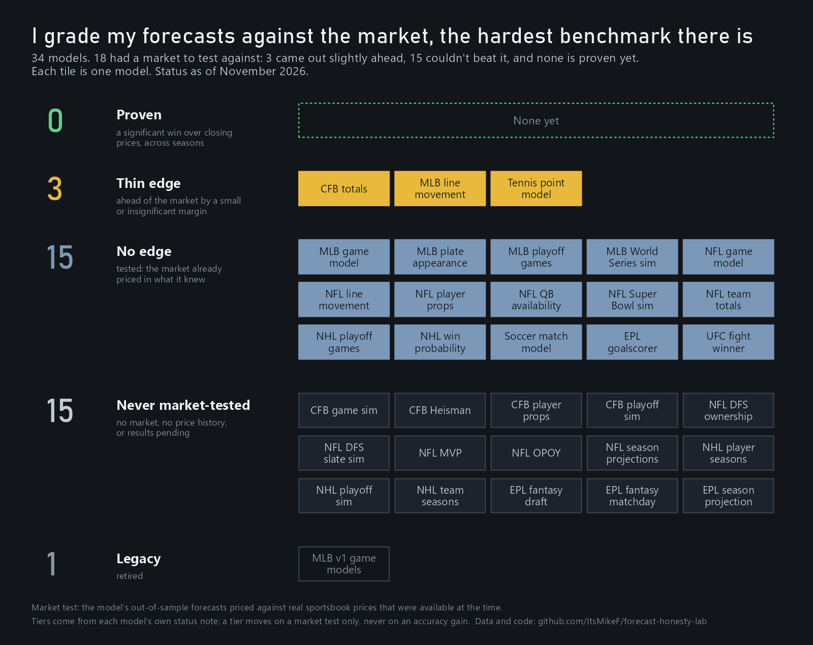

# Forecast honesty lab

**I grade my forecasts against the market, the hardest benchmark there is.** Of 34 forecasting
models, 18 had a market to test against: 3 came out slightly ahead, 15 couldn't beat it, and none is
proven yet.

This repo is the scorecard for every forecasting model I've documented, with every result
published, misses included. It also covers the eight lessons those tests taught me about checking
a forecast honestly.



## Why grade a forecast against a market?

Beating a naive baseline proves very little. Almost any model beats last year's average. The
useful question is whether a forecast knows something the best available forecast doesn't. In
sports, the best available forecast is the betting market. It's liquid, it's sharp, and it absorbs
public news within minutes.

So every model here is graded on forecasts it made out of sample, against prices that were really
available at the time. A model moves up a tier only when it beats those prices, never because its
accuracy improved.

The same bar applies outside sports. A demand plan or a supplier-risk score has to beat the
forecast it would replace, not a moving average.

## The scorecard

**How to read the results:**
- **Return** is the backtested profit of an equal stake on every forecast that disagreed with the
  market by more than a set margin, at the best available price.
- **t** is how many standard errors that return sits from zero. Below about 2, it can't be told
  apart from luck.
- **Closing-line value** asks whether the price moved toward the forecast before the event.
- **Log loss, Brier and ranked probability score** measure a forecast's error directly. They are
  compared with the market's own error, where lower is better.

<!-- scorecard:start -->
### Thin edge (3): ahead of the market, not yet proven

| Model | Forecasts | Tested on | Result | Caveat |
|---|---|---|---|---|
| **CFB game model (totals)** | Total points in each game | ~1,300 games, 2020–25, where the forecast differed from the line by 5+ points | +4.7% at the opening price (t 1.78), +6.0% at the close (t 2.23) | Its settings were chosen on this same metric, so only the untouched 2026 season can confirm it. The same model's winner (−3.4%) and spread (−5.6%) forecasts lost. |
| **MLB line movement** | Which way a game's price moves from open to close | 668 games, 2023–26, one forecast per day | +2.4% (t 0.65); beat the closing price on 79% of games (+2.40 pts) | Ranking beat thresholds: taking only the top forecast each day roughly doubled the closing-price gain (+1.27 → +2.40 pts). |
| **Tennis point model** | Match winners, built up from serve and return points (point → game → set → match) | 24,368 matches, 2013–25; 18,161 forecasts at a 3% edge | +1.9% at the best closing price (t 1.65, not significant) | A Masters 1000 slice reads +11.2% (t 4.97), but it was found by slicing, so the 2026 season decides it. |

### No edge (15): tested, and the market already priced in what they knew

| Model | Forecasts | Tested on | Result | What it taught me |
|---|---|---|---|---|
| **MLB game model** | Game winners and total runs | 11,095 games, 2022–26, open and close | Winners −1.1% to −2.6%, totals −5.7% to −7.6% at the close, at every threshold | Both the opening and the closing prices beat it; its closing-line value was negative everywhere. |
| **MLB plate-appearance model** | 10 outcomes per plate appearance (XGBoost on Statcast), feeding player stat lines | 11,533 forecasts across 19 days of 2024 | −1.6% to +0.8% across thresholds; nothing significant | The first test read +5.97% (t 2.52). The model had trained on the season it was graded on; an as-of model removed 3.6–5.8 points from every band. |
| **MLB playoff game model** | Postseason winners and totals | 208 games, 2021–25 | Log loss 0.706 vs the market's 0.693 (a coin flip scores 0.693); −11.2% at the close | A regular-season retest on 6,310 games agreed: its disagreements with the market were error, not edge. |
| **MLB World Series sim** | Champion odds, refreshed monthly | 20 monthly boards, 2022–25 | Log loss 2.169 vs the market's 2.059; −32.9% to −44.2% | A genuine roster fix made it more accurate, and it still lost: accuracy and edge are different currencies. |
| **NFL game model** | Spreads, totals and winners | 2020–25, ~280 forecasts per market, pre-registered | Taken at the opening price and valued at the close: spreads −2.2%, totals 0.0%, winners −1.6% | Pre-registered before it ran. The line did move toward it, but by less than the bookmaker's margin. |
| **NFL line movement** | Weekly point-spread moves, from momentum and injury news | 2022–25, walk-forward | Forecast R² 0.016; the injury features added nothing (0.013) | Its first backtest showed +16–27% at t > 4. That was a leak (it compared against future prices), caught by an adversarial review before anything was used. |
| **NFL player projections (stat lines)** | Player stat lines (passing TDs, yards, receptions) | 2025 holdout, then the live 2026 season | Passing TDs +3.7% (t 0.50) once filtered-out games were restored; live 2026 weeks 2–4: −14.4% | A data filter on each game's own stats had deleted the bad outcomes: +13.6% became +3.7%. |
| **NFL QB availability** | Point impact of a missing starting quarterback | 1,605 games, 2020–25 | −2.71% at the close; the effect is real (−3.45 points, t −4.28) but fully priced in | The more public and scheduled the news, the more surely the market already has it. |
| **NFL Super Bowl sim** | Champion odds through the season | 47 snapshots, 2020–25 | Log loss 2.527 vs the market's 2.440; ahead at 21 of 47 snapshots | Its disagreements didn't predict where the price went next (correlation 0.02). |
| **NFL team totals** | Points per team per season | 192 team-seasons, 2020–25 | Correlation with actual points 0.321 vs the market's 0.463 | 8.3% more accurate than a 3-year baseline, and it still knew nothing the market didn't. |
| **NHL playoff game model** | Playoff game winners | 433 games, 2022–26 | Brier 0.2464 vs the market's 0.2403; −12.0% (t −2.01) | A playoff-only model trained on 1,593 playoff games did worse. |
| **NHL win probability** | Game winners | 6,451 games, 2021–26, pre-registered | Brier 23.67 vs the close's 23.30; −2.1% at the morning price | The top pick each night returned +5.7%, but valued at closing prices it was −1.7%: variance, not skill. |
| **Soccer match model (Dixon-Coles)** | Win / draw / loss | 10,674 matches, 6 seasons | Ranked probability score 0.2027 vs the opening line's 0.1980; negative at every threshold and book | Its real skill was forecasting the price move, not the match. Serving stale ratings turned that skill negative (−1.14% vs +2.49% closing-line value). |
| **EPL goalscorer model** | Anytime goalscorer | 254 forecasts after a start-probability gate | +22.7% with the gate (t 1.01, not significant); −11.9% without | Grading at the closing board, which drops players who won't play, turned −20.9% into +21.4%. |
| **UFC win probability** | Fight winners | 728 fights, 2024–26 | −18% at the close; AUC 0.644 vs the market's 0.776 | An early-price arm showed a profit with zero closing-line value: variance, not skill. |

<details>
<summary><b>Never market-tested (15) and retired (1)</b>: no market exists, no price history exists, or results are pending</summary>

| Model | Forecasts | Status |
|---|---|---|
| CFB game sim | Game score distributions | Display tool; used only as a calibration check |
| CFB Heisman model | Heisman Trophy odds | No price history exists |
| CFB player props model | Player stat lines | Lines exist, but no prices |
| CFB playoff sim | Playoff and title odds | Awaiting its first settled season (January 2027) |
| MLB game-level models (v1) | Game outcomes (four early models) | Retired |
| NFL DFS ownership model | Daily-fantasy ownership shares | No market exists |
| NFL DFS slate sim | Lineup score distributions | No market exists |
| NFL MVP model | MVP odds | No price history exists |
| NFL OPOY model | Offensive Player of the Year odds | Thin price history; awaiting results |
| NFL season projections | Player season stats | No market; lost to draft-room consensus (ADP) on a field test |
| NHL player season projection | Player season points | No market exists; outcome-tested only |
| NHL playoff sim | Series and Cup odds | Not tested directly; its game engine was (NHL playoff games) |
| NHL team season projection | Team points and Cup odds | Cup board tested: inconclusive |
| EPL fantasy draft projections | Season fantasy points | No market exists |
| EPL matchday projections | Weekly fantasy categories | No market exists |
| EPL season projection | League finish odds | Priced; awaiting results (May 2027) |

</details>
<!-- scorecard:end -->

## What the tests taught me

### 1. The model has to be as-of, not just the data
My MLB plate-appearance model first tested at **+5.97% (t 2.52)**, which would have been my first
significant result. But the scoring model had been trained on the same season it was being graded
on.

I retrained it only on earlier data and re-ran the same games at the same prices. It lost **3.6–5.8
points in every band at once**, and nothing stayed significant. Keeping the features as-of isn't
enough; the model itself has to be. One more catch: the leaked model *looked* well calibrated, so
good calibration can itself be a symptom of a leak.

### 2. Accuracy is not edge
My NFL team-totals model is **8.3% more accurate** than a three-year baseline, on all nine stats it
forecasts. Its correlation with actual points is still **0.321, against the market's 0.463**.

My World Series simulator got more accurate after a genuine roster fix, and it still couldn't beat
the market. A model
can beat every baseline you choose and still know nothing the market doesn't.

### 3. Every new feature has to beat random noise
Adding five columns of pure random noise to my NFL tight-end model *improved* it out of sample: the
squared correlation rose from **0.183 to 0.202**, and the RMSE fell from 5.97 to 5.89.

In a random forest that samples few variables per split, extra columns pull predictions toward the
mean. That helps whenever a model is over-confident. So "the metric went up" can't tell a real
feature from padding. Now every candidate feature has to beat a noise arm with the same number of
columns.

### 4. Never filter on the outcome
My NFL quarterback backtest kept only games where the QB threw more than 10 passes for more than
150 yards. That quietly deleted the bust games. With them put back, the passing-TD result fell from **+13.6% to
+3.7% (t 0.50)**.

A filter on a game's own stats is a filter on the answer. Only information that existed before the
game is allowed to choose the sample.

### 5. Grade at the price you could actually get
Bookmakers drop players from their boards once team news lands, so a closing board lists almost
only players who played. In my Premier League goalscorer archive, the best forecast each matchday
returned **+21.4%** when graded at the close.

Graded a day ahead, when the bet could actually have been placed, it returned **−20.9%**. Same
forecasts, opposite sign.

### 6. Separate skill from luck with the closing price
An earlier version of my NHL model returned **+11.9% over 863 games (t 2.62)** on its top pick each
night. The closing price
absorbs everything learned before puck drop. Valued at that price, the same picks had an expected
return of **−1.9%**.

Realized profit is noisy. The closing price tells you whether the forecast was good when it was
made, so every test here reports both numbers.

### 7. Rank, don't threshold
Raising the minimum edge made my MLB line-movement model *worse*. Its closing-line value was
**+0.87 points** at a 3-point threshold against **+1.27** at 1 point. Taking only the single
best-ranked forecast each day nearly doubled it, to **+2.40**.

The most extreme outputs come from unusual or imputed inputs, so the biggest numbers are the least
trustworthy. The ordering holds up.

### 8. The model you serve must be the model you tested
My soccer model's backtest refit team ratings as each season went on. That version beat the closing
price **57.7%** of the time, for **+2.49%** closing-line value. The version actually producing
forecasts used frozen preseason ratings. On the same 2,269 matches it scored **43.9% and −1.14%**,
worse than a coin flip.

The gap sat in my notes as a known issue for four weeks. Quote a backtest only for the exact model
that is serving.

## How the tests work

- **Out of sample, as-of.** Each model is trained only on data from before the period it's graded
  on, and that includes the model itself, not just its features.
- **Real prices.** Prices come from historical archives (The Odds API, tennis-data.co.uk, ESPN). The
  test uses the best price at books I can actually use, not a consensus median nobody can get.
- **Pre-registration.** For the larger tests, the metric, the sample and the pass bar are written
  down before the test runs.
- **Controls.** These include:
  - noise-feature arms;
  - shuffled-label nulls sized to the real sample;
  - an "oracle" arm with perfect information, which caps what a better input could ever add.
- **Clustered errors.** t-statistics are clustered by day, slate or series, because forecasts on
  the same day aren't independent.

## What's in this repo

| Path | What |
|---|---|
| `data/models.csv` | Every model: what it forecasts, its tier, sample, result and lesson. One row per model. |
| `R/plot_scorecard.R` | Draws the chart above (ggplot2 + ragg). |
| `R/render_readme.R` | Writes the scorecard tables in this README from the CSV, so the two can't disagree. |

The models themselves live in a private repository, because they run on licensed data (PFF and The
Odds API) that can't be redistributed. This repo publishes the results and the methods.

To rebuild the chart and the tables:

```bash
Rscript R/plot_scorecard.R
Rscript R/render_readme.R
```

## About

I'm Michael Francis, a supply chain planner who builds forecasting systems in R. I built these with
[Claude Code](https://claude.com/claude-code) as an AI pair programmer. I direct the questions and
make the calls; the code, the tests and the write-ups are a collaboration.

Code: MIT licence.
